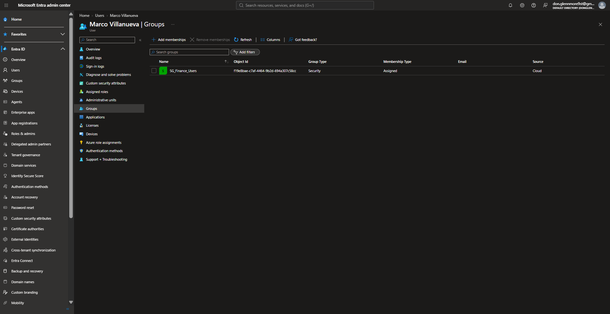
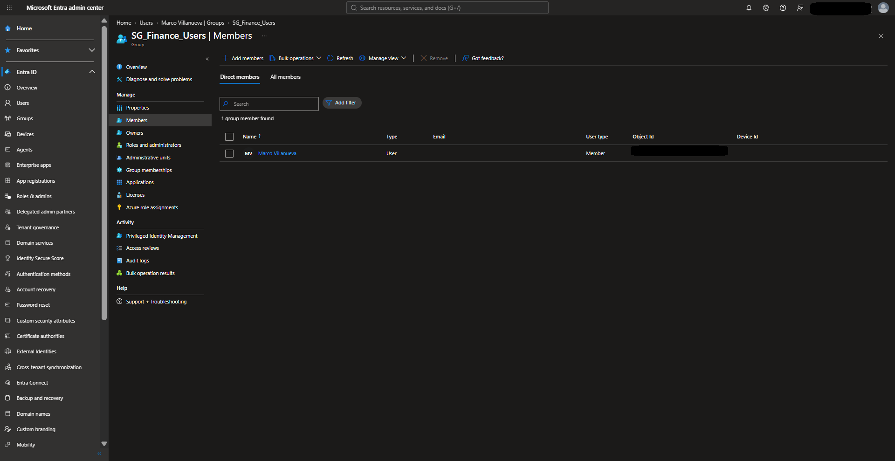
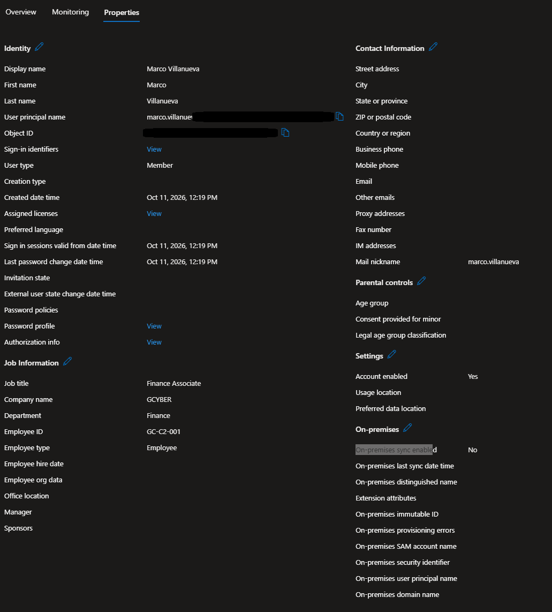
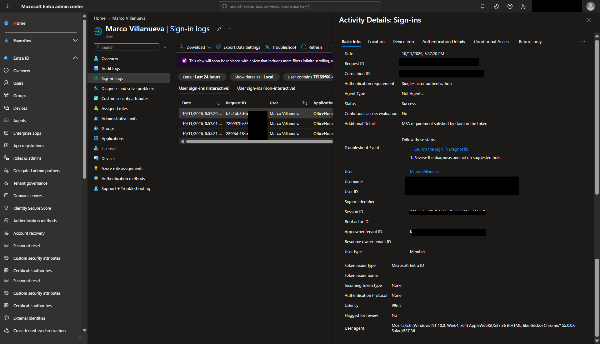
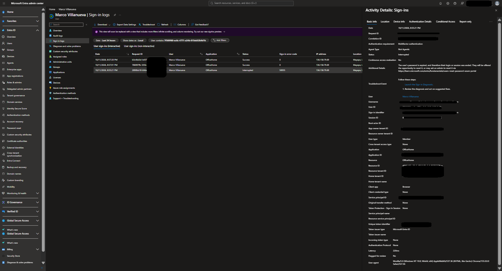
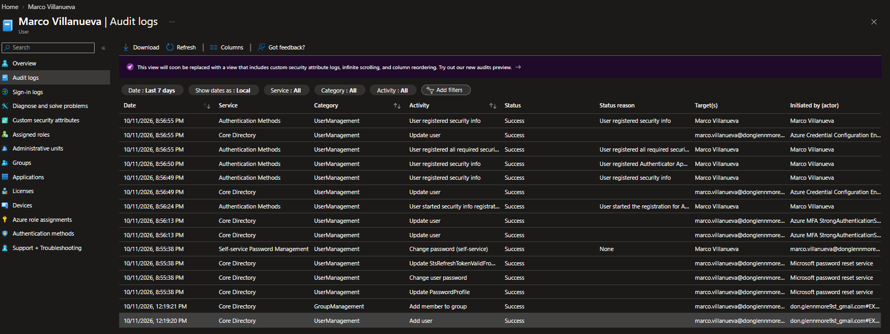

# Microsoft Entra Joiner Access Validation Case 02

Hands-on IAM case demonstrating joiner identity setup, Finance access assignment, direct group membership validation, authentication verification, password troubleshooting, and directory audit review in Microsoft Entra ID.

## Project Scenario

A new Finance user was onboarded and assigned required access in Microsoft Entra ID.

The objective was to verify that the identity was correctly configured, confirm direct Finance group membership, validate authentication, troubleshoot a password-related issue, and review the resulting directory audit trail.

## Key Result

The joiner workflow was successfully validated through:

- Finance group verification
- direct membership confirmation
- identity attribute review
- successful authentication
- expired-password root-cause identification
- directory audit verification

## Tools & Technologies

Microsoft Entra ID · Microsoft 365 · Microsoft Entra Sign-in Logs · Audit Logs · Security Groups · Identity Attributes

## Evidence Gallery & Validation

The screenshots below document the Lab 1.2 workflow from access setup through authentication and audit verification.

### 1. Finance Group Verified

Confirmed the target Finance security group used for the joiner access assignment.



---

### 2. Direct Finance Group Membership Verified

Validated that the joiner identity was directly assigned to the required Finance group.



---

### 3. Joiner Identity Attributes Verified

Reviewed the new user's Microsoft Entra identity attributes to confirm the expected account information and Finance-related configuration.



---

### 4. Successful Authentication Verified

Validated successful authentication for the joiner identity after access setup.



---

### 5. Expired Password Root Cause Identified

Investigated an authentication issue and identified an expired password condition as the root cause.

This demonstrated the difference between an identity/access configuration problem and an authentication credential issue.



---

### 6. Joiner Directory Audit Trail Verified

Reviewed Microsoft Entra audit activity to validate the joiner-related directory changes and provide an auditable record of the identity workflow.



## IAM Concepts Demonstrated

- Joiner lifecycle operations
- User identity validation
- Security group access assignment
- Direct group membership verification
- Authentication validation
- Password troubleshooting
- Microsoft Entra sign-in review
- Directory audit verification
- Access verification
- Evidence-based IAM documentation

## Workflow

```text
Joiner Identity Setup
        ↓
Finance Access Assignment
        ↓
Membership Verification
        ↓
Identity Attribute Review
        ↓
Authentication Validation
        ↓
Password Troubleshooting
        ↓
Directory Audit Verification
